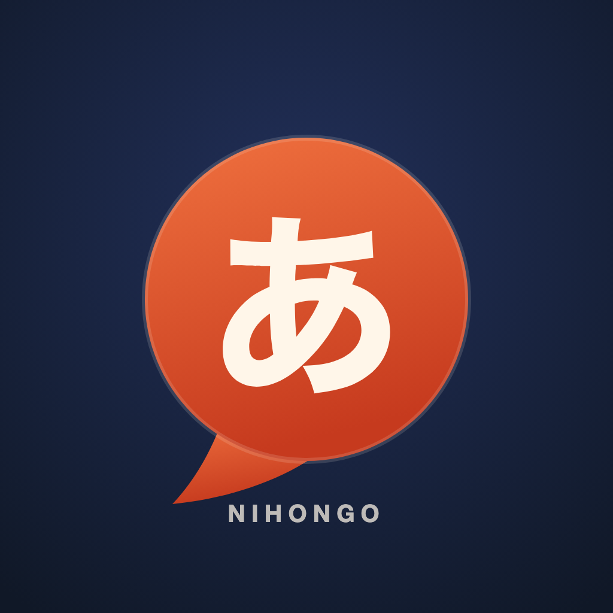
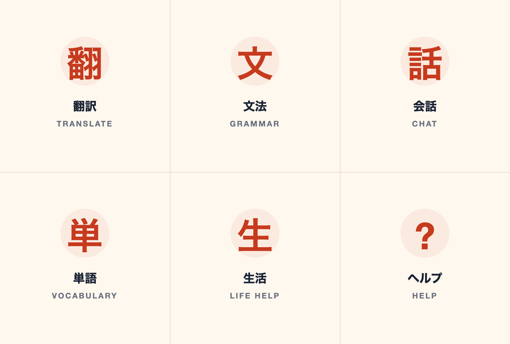

# Nihongo Companion



A LINE bot for learning Japanese and getting through everyday life in Japan.

I built this because I kept bouncing between a dictionary, a grammar site and a
translation app whenever I got a message I didn't understand, or had to read a
notice from city hall. LINE is where those conversations already happen in Japan,
so putting the assistant there felt more useful than building another web app.

It's a TypeScript/Express service that talks to the LINE Messaging API and Google
Gemini, with SQLite for conversation memory and reminders. I've been using it with
my own LINE account while building it.

## What it does

**Japanese**

- Translate Japanese ⇄ English with a short note on nuance and politeness
- Explain a grammar pattern with examples and a common mistake
- Correct a sentence and explain what changed
- Teach vocabulary with readings and example sentences
- Practise conversation at your JLPT level
- Draft casual, polite and business (keigo) Japanese

**Everyday life**

- Read signs, menus, notices and forms from a photo
- Explain what a notice is actually asking you to do
- Give you the phrase to say or show to staff

**Other**

- Reminders in English or Japanese ("remind me in 30 minutes to…", "明日の8時に…")
- Memory: recent turns plus a rolling summary, so conversations continue
- Quick-reply buttons and a rich menu for switching modes

## A note on language

The bot replies in Japanese by default, with readings for kanji, and doesn't append
an English translation under every line. If I want English I ask for it ("in
English", "what does that mean?"). Translate mode is the obvious exception.

I made this a hard rule in the system prompt after getting replies that repeated
every sentence three times: Japanese, romaji, English. It made the chat unreadable.

## Modes

`auto`, `translate`, `grammar`, `correction`, `vocab`, `conversation`, `keigo`, `life`.

`auto` lets the model decide what the message needs. The rest are focused prompts —
same code path, different instructions and follow-up buttons.

## Commands

| Command | Effect |
|---|---|
| `/help` | Feature overview and command list |
| `/mode` | Show the mode picker |
| `/mode grammar` | Switch mode |
| `/level` | Show the JLPT level picker |
| `/level n4` | Set your level (n5–n1) |
| `/progress` | Level, mode, message count and a summary of what you've covered |
| `/clear` | Delete this chat's conversation memory |
| `/reminders` | List upcoming reminders |
| `/delete 2` | Cancel reminder #2 |
| `/id` | Show your LINE user ID (1:1 only) |

Reminders also work without a slash command:

```
remind me in 30 minutes to stretch
remind me to call the dentist in 2 hours
remind me at 8pm to take medicine
明日の8時に歯医者に行くのをリマインドして
```

Times are interpreted in JST (UTC+9). "at 8" with no am/pm resolves to the next
8:00 or 20:00. "tomorrow" with no time defaults to 09:00 and the bot says so.

## How it works

```
LINE platform
    │  POST /webhook (signature verified by the LINE middleware)
    ▼
Express ──► 200 OK immediately          ← LINE retries slow / non-2xx deliveries
    │
    ▼
dedupe by webhookEventId (SQLite)
    │
    ├── text ──────► command router ──► SQLite ──► reply with quick replies
    │                    └────────────► Gemini ──► reply with quick replies
    ├── image ─────► download ────────► Gemini vision ──► reply
    ├── postback ──► mode / level / follow-up prompt
    └── follow / join / leave / unfollow
    │
    ▼
replyMessage (free) ──expired or failed──► pushMessage (quota)
```

The webhook responds before doing any model work. LINE retries deliveries that are
slow or return non-2xx, so blocking the response on a Gemini call is a good way to
get duplicate replies.

### Files

| File | Responsibility |
|---|---|
| `src/index.ts` | Server wiring, DB init, reminder loop, graceful shutdown |
| `src/line.ts` | Webhook, event routing, mentions, images, reply/push fallback |
| `src/commands.ts` | Slash commands, postbacks, quick replies, help text |
| `src/ai.ts` | Persona, modes, prompt assembly, memory, summarisation |
| `src/gemini.ts` | One Gemini round-trip with timeout, abort and 503 retries |
| `src/database.ts` | SQLite schema and queries (`better-sqlite3`) |
| `src/reminders.ts` | Time parsing (EN/JA, JST) and the delivery loop |
| `src/text.ts` | Message splitting and mention stripping (pure functions) |
| `src/richmenu.ts` | Creates and installs the rich menu |
| `src/selftest.ts` | Offline checks, no network |

### Database

```
users          user_id, display_name, mode, jlpt_level, native_lang, is_friend
conversations  convo_id, kind, summary, summary_through_id
messages       id, convo_id, role, content
reminders      id, user_id, target_id, target_kind, text, due_at, attempts, sent_at
webhook_events event_id, received_at          (dedupe, pruned after 7 days)
```

`convo_id` is the user id in 1:1 chats and the group/room id in groups, so each
conversation keeps its own memory.

## Running it

Node 20+ (I'm on 24). You need a LINE Messaging API channel and a Gemini API key.

```bash
npm install
cp .env.example .env
# fill in LINE_CHANNEL_ACCESS_TOKEN, LINE_CHANNEL_SECRET and GEMINI_API_KEY
npm run dev
```

Expose it and point LINE at `https://<your-host>/webhook`:

```bash
cloudflared tunnel --url http://localhost:3000
```

In the LINE Official Account Manager:

- enable **Use webhook**
- disable auto-reply and greeting messages, or every reply is sent twice
- enable **Allow bot to join group chats** if you want group support

### Rich menu

The rich menu is a 2500×1686 PNG. Mine is in `assets/richmenu.png`; the six tap
areas are wired to the same postback actions as the quick replies.

```bash
npm run richmenu -- ./assets/richmenu.png
npm run richmenu -- --list
npm run richmenu -- --delete
```

<p align="center">
  
</p>

Other assets:

| File | Use |
|---|---|
| `logo.png` (1024×1024) | LINE Official Account profile image |
| `logo-640.png` (640×640) | Smaller upload variant |
| `logo.svg` | Editable master |
| `richmenu.png` / `richmenu.svg` | Rich menu image / editable master |

## Testing

```bash
npm test                            # offline: parsing, splitting, DB, command routing
npm run gemini                       # one live Gemini call
npm run prompt -- conversation n5    # print the exact system instruction
```

The self-test covers the parts I can check without hitting LINE: JST time parsing,
English and Japanese reminder phrases, message splitting, mention stripping,
database behaviour, webhook de-duplication and command routing.

There are also two smoke scripts I use while developing:

```bash
node scripts/smoke-webhook.mjs http://127.0.0.1:3000/webhook "/help"
DB_PATH=/tmp/ai.db npx tsx scripts/smoke-ai.ts
```

The first sends a correctly signed webhook with a fake reply token, so it exercises
signature verification and the reply→push fallback without sending anything to a
real user. The second checks memory across two real Gemini calls.

## Groups

The bot works in groups and multi-person chats, with limits I added on purpose:

- It replies only when @mentioned or when a message starts with `/`.
- Images are ignored in groups. Image events carry no mention information, so the
  bot can't tell whether it was addressed, and replying to every photo is awful.
- Personal mode/JLPT settings are ignored in groups. One member's settings
  shouldn't reshape everyone else's answers, so groups run in `auto` at N5.
- When the bot is removed from a group, that group's stored messages are deleted.

## Privacy

- Message text is stored in SQLite for memory. It is not written to logs.
- `/clear` deletes the current chat's messages and summary.
- Photos are downloaded and sent to Gemini for analysis; they aren't stored on disk.
- LINE user/group IDs are stored to key conversations and reminders.
- Everything lives in the local SQLite file (`DB_PATH`). Nothing else is persisted.

## LINE platform limits

These shaped the design more than anything else:

- **Reply tokens are single-use and expire after about a minute.** The bot replies
  with the token when it can and falls back to a push message if it's rejected.
- **No streaming and no editing a sent message.** The only "working" indicator LINE
  offers is the loading animation, and that only works in 1:1 chats.
- **Max 5 messages per send, 5000 characters per text message.** Long answers are
  split on paragraph boundaries and truncated with a notice after five messages.
- **Push messages use the plan's monthly quota.** Replies are free; reminders and
  fallbacks are not.
- **Text messages don't render Markdown.** The prompt forbids it; replies use plain
  text and `・` bullets.

## Known limitations

- The reminder scheduler is in-process, so run one instance. A second one would
  double-send.
- Group support is deliberately narrow: no images, no per-group settings.
- Summarising a long conversation costs an extra Gemini call.
- There are no automated tests for the LINE transport itself. The smoke script is
  the closest thing.

## Next

- Spaced repetition for vocabulary instead of one-off word lists
- Voice messages (LINE sends audio as a separate message type)
- Per-group settings
- A tiny admin page for reminders and user counts

## Development

```bash
npm run dev        # tsx dev server
npm run build      # tsc → dist/
npm start          # run the compiled output
npm test           # offline self-test
```

Credentials belong in `.env`, which is gitignored, along with `data/` and the
compiled `dist/`. Webhook requests are authenticated by the LINE SDK's signature
middleware.

## License

ISC. See `LICENSE`.
